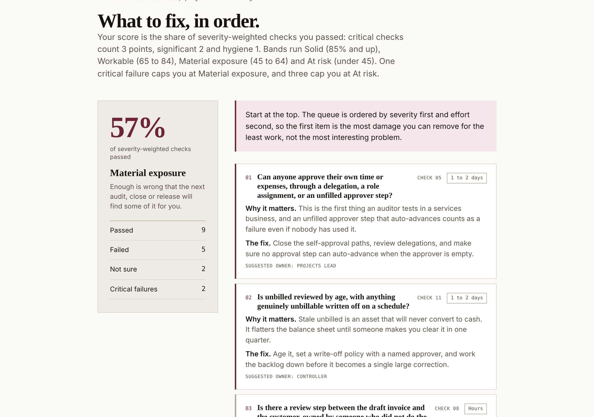

# Workday Financials Health Check

**Free. Sixteen checks per area, about twenty minutes. Your answers never leave your browser.**

**Run it:** https://saintilco.com/healthcheck.html

For higher ed, public sector and services teams. Pick one of four areas of a Workday Financials tenant:

1. Financial reporting and statements
2. Customer accounts, contracts and revenue
3. Grants and sponsored programs, post-award
4. Professional services, projects and billing

Each check names the task or report to run, what a healthy answer looks like, and what it costs you when the answer is no. At the end you get a ranked fix queue.

## How it is scored

Shown on the page: your score is the share of severity-weighted checks you passed. Critical checks count 3 points, significant 2 and hygiene 1. Bands run Solid (85% and up), Workable (65 to 84), Material exposure (45 to 64) and At risk (under 45). One critical failure caps you at Material exposure, and three cap you at At risk. "Not sure" is counted, never passed.

## Sample

`samples/example-fix-queue.pdf` is the printed fix queue for a made-up run of area 4 (professional services, projects and billing).

## How it is tested

Checked in Chrome against the live build on 11 November 2026, on area 4. All 4 scenarios passed:

| Scenario | Expected and seen |
|---|---|
| All 16 Pass | 100%, Solid, nothing queued |
| All 16 Fail | 0%, At risk, 16 failed, 6 critical |
| All 16 Not sure | Counted as not sure, not passed |
| One critical check failed, the rest passed | 92%, capped at Material exposure |

## What this repository is

A showcase: what the tool does, what it looks like, made-up sample files to try it with, and how it is checked. The tool itself runs on saintilco.com. **No source code, test suites or answer keys are published here.**

Everything in `samples/` is fictional. No client data, real names or real figures appear anywhere in this repository.

## About

Built by [Saintilco Consulting](https://saintilco.com), independent Workday Financials controls reviews. Saintilco Consulting is not affiliated with, sponsored by, or endorsed by Workday, Inc. WORKDAY is a trademark of Workday, Inc. Commercial and systems guidance only, not legal, tax, accounting or audit advice.

Copyright 2026 Saintilco Consulting. All rights reserved. No license is granted to copy, modify or redistribute the tool or this material.
